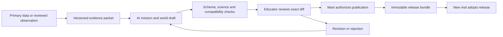

# My Universe — an expanding universe built from evidence

2 November 2026 · Lead developer proposal for Mani · Planning and content design

**Product promise: Human discovery opens a question. A new world gives learners somewhere to investigate it. Their evidence changes what happens next.**

This proposal builds on the supplied Opus development report, the local Universe handoffs and the existing catalog. It is a plan, not a release authorization. No mission has been activated, branch merged, backend deployed, production data changed or scheduled job created by preparing it. All new worlds and missions below are proposed drafts.

The companion [Mission Atlas](MY-UNIVERSE-MISSION-ATLAS-2026-11-02.md) contains eight worlds and 24 mission scenarios, including the first three worlds already in the catalog.

The [three-agent assignments](MY-UNIVERSE-THREE-AGENT-ASSIGNMENTS-2026-11-02.md) allocate delivery specifically to GPT 6.1, Opus 5.5 and Gemini 4 Argon. The functional roles below belong to that team; no additional AI agent is needed by default.

## 1. The experience we should build

My Universe should feel like joining a research expedition, with places worth exploring and questions worth caring about. It should also teach learners how knowledge is built: observe, question, test, explain, revise and communicate.

The repeatable experience is:

**Discover a signal → inspect the evidence → visit a world → choose a mission → investigate or build → explain a decision → receive human feedback → open another possibility.**

An example: a learner sees a new expedition beacon over Thalassa. A field station wants to understand why two wind sensors disagree. The learner examines units and timestamps, spots a blocked sensor, compares two locations and recommends a measurement plan. Later, that evidence becomes part of a floating-city energy design. A diagram, spoken explanation or annotated chart can demonstrate the reasoning. Watching the scenery or clicking every sensor cannot complete the mission.

The universe has three complementary layers:

| Layer | Learner experience | Truth rule |
|---|---|---|
| Real Discovery Observatory | Inspect real objects, measurements, research methods and changing scientific explanations. | Real claims link to reviewed evidence, with uncertainty and dates. |
| Fictional expedition universe | Travel through Lyra, Aurora and later authored galaxies, planets and research stations. | These are fictional places inspired by science. Their values are never presented as astronomical measurements. |
| Mission workspace / field notebook | Predict, compare data, make models, test designs, explain and revise. | Recorded observations, supplied datasets and model outputs remain visibly distinct. |

The observatory is a view of evidence, not a second navigable product or a replacement for the existing Universe hierarchy. It can begin as a compact evidence panel within a mission.

**A finding about a real planet does not justify inventing a newly discovered real galaxy.** AI should first ask whether the evidence improves an existing mission, adds a workstation, supports a new planet, or supports a coherent collection of worlds. A new fictional galaxy is a substantial educational expansion, not the daily unit of output.

## 2. What the report establishes, and what needs checking

The report describes a live catalog with two fictional galaxies, one system, three planets and two landable environments; several backend/frontend/workstation branches remain separate. Local inspection corroborates the catalog structure and the referenced development lines. It does not verify today's deployed revision, current remote PR status, production backend state or the reported test/performance results.

| Finding from local inspection | Planning consequence |
|---|---|
| The root workspace is on the older `0b6300f` line and contains substantial unrelated work. | Keep this task to new planning files; implementation must use the reconciled release line. |
| Cached `origin/main` is `3e46119`, already containing a Universe merge through PR #4, while the prototype line includes the later live-safe `44b3abc` change. | Fetch and inspect the actual graph before integration. Do not blindly replay “merge PR #6, then four branches.” Cached refs do not establish the remote state. |
| Existing IDs are `lyra-spiral`, `aurora-elliptical`, `lyra-prime`, `thalassa`, `ignis`, `boreas`. | Preserve IDs and existing geography. Populate empty Aurora before adding more galaxies. |
| Boreas is a ringed **ice giant**, with no landable environment. | Use an orbital station and atmospheric probe missions. A solid ice landscape would need a separately authored world or moon. |
| Boreas's authored requirement describes Ice and Climate, but the backend demonstration uses a spacecraft-journey approval. | Educator and Mani must choose the real access policy before activation. The demo mapping is not a final curriculum decision. |
| Current validated planet kinds and scenes are finite: `ocean|basalt|ice`, `ocean-station|basalt-fissures`. | New biomes require reviewed code and schema changes. AI cannot add a new renderer through catalog text. |
| Frontend and backend mission definitions currently live separately. | Generate both from one reviewed mission bundle to prevent contradictory completion/unlock rules. |

Internal reference: [canonical Universe alignment](../../output/my-universe/source/UNIVERSE.md), especially §13 and the later release notes. The earlier [1 November implementation plan](MY-UNIVERSE-IMPLEMENTATION-PLAN-2026-11-01.md) describes a superseded floating-island direction; it is not the visual baseline for this proposal. This new document does not silently replace the canonical alignment or another agent's handoff.

## 3. A universe with distinct places and connected learning

Preserve the two existing fictional galaxies. Expand to four only when each new region can support a coherent expedition. The themes below are curricular identities, not claims about what an astronomical galaxy contains.

| Fictional galaxy | Worlds in the proposed atlas | Identity and expansion purpose |
|---|---|---|
| **Lyra Spiral — Frontier of Forces**; existing `lyra-spiral` | Thalassa, Ignis, Boreas remain in `lyra-prime`. | Ocean systems, volcanic landscapes, atmosphere and exploration engineering. This is the first pilot. |
| **Aurora Elliptical — Living Systems**; existing `aurora-elliptical` | Proposed Verdantia and Cryora, in new authored systems. | Ecosystems, water, ice, climate and evidence about change. The first expansion should make this existing empty galaxy meaningful. |
| **Prism Reach — Signals and Discovery**; future fictional spiral concept | Proposed Lumen; a second complementary world is not yet specified. | Light, waves, telescopes, exoplanet evidence, uncertainty and responsible AI. Keep the galaxy unpublished until the two-world planning gate is met; Lumen missions can begin through existing mission navigation. |
| **Forge Spiral — Futures We Build**; proposed fictional spiral | Proposed Solara and Tessera. | Energy, materials, design, circular systems and choices for communities. |

New system names, orbit arrangements and fictional values must be authored and checked. A curriculum theme must not imply an unsupported physical property of a real galaxy. Until the new galaxy release is coherent, its missions can be previewed from existing mission navigation without publishing empty destinations.

| World | Planet mission range, proposed | First invitation | Environment strategy |
|---|---|---|---|
| Thalassa | Challenge 1–4 | “Which sensor should the research station trust?” | Reuse ocean station and existing workstations. |
| Ignis | Challenge 2–4 | “Which journey plan can deliver our instruments?” | Reuse basalt fissures; no claim that glow or gas is a scientific simulation. |
| Boreas | Challenge 2–4 | “How do you investigate a world you cannot stand on?” | Start with a full text/data investigation; later reviewed orbital/probe scene. |
| Verdantia | Challenge 1–4 | “Why are the pollinators missing from one valley?” | First new biome: a bounded ecological field station. |
| Cryora | Challenge 2–4 | “Why do two ice maps tell different stories?” | New rocky glacial world, distinct from Boreas. |
| Solara | Challenge 1–4 | “Can a settlement share reliable power fairly?” | Reuse audited solar and energy activities before making a new desert renderer. |
| Lumen | Challenge 2–5 | “Is that a planet signal—or a misleading pattern?” | Observatory workspace first; surface later. |
| Tessera | Challenge 2–4 | “Can a useful city produce less waste?” | Materials/workshop workspace first; city scene later. |

These ranges are editorial proposals for the 24 draft missions. They must not appear as live planet statistics before the corresponding missions are published and accessible. A data mission can become usable through the complete non-3D view before its custom surface exists, if the learner is told exactly what is available.

## 4. Difficulty that explains the task

Use five **challenge levels**, separate from age, NGSS grade band, language, reading level, accommodations and support settings.

| Level | Task demand | Typical evidence |
|---|---|---|
| 1 · Observe and compare | Observe or compare a small supplied set against given criteria; make a simple supported choice. | Labeled observations and one justified distinction or recommendation. |
| 2 · Investigate | Choose a question, control a variable or compare measured patterns. | A fair comparison, units and an evidence-based explanation. |
| 3 · Explain and build | Connect a model to observations or compare competing designs. | An annotated model/design, criteria and a reasoned choice. |
| 4 · Optimize a system | Work across interacting variables and competing constraints. | Iterations, tradeoffs, sensitivity checks and limitations. |
| 5 · Research a question | Handle incomplete/noisy evidence, alternatives and an open result. | A reproducible method, uncertainty and a defensible conclusion, including “not enough evidence.” |

The editor rates evidence complexity, variable interactions, reasoning, design constraints and uncertainty. The most demanding required component sets the provisional mission level; an educator confirms it with the actual task and exemplar. Do not average labels into a false measure of intelligence.

Each mission offers **Guided**, **Independent** and, where appropriate, **Extension** support routes. Guided adds worked methods, fewer initial choices and sentence/diagram starters; it preserves the target reasoning. An extension that changes the assessed demand gets a separately reviewed task/variant. Retain existing `guided` and `advanced` mission keys during migration rather than silently changing saved submissions.

The planet label is computed from its current published mission routes:

- “Entry challenge” = lowest available introductory mission demand, not the planet's apparent danger or visual complexity.
- “Mission range” = minimum–maximum demand of the published missions in the displayed scope. Exclude hidden drafts, retired missions and unavailable variants.
- Offer separate catalog-wide and “available to you” ranges where needed; include a count so one advanced mission does not misrepresent the whole planet.
- A planet with no published mission shows “Exploration only / missions being prepared,” never a fabricated number.
- A learner can ask for more support, pause or choose another relevant mission without a penalty or lowered-status label.

Example after the proposed set is actually approved: **Thalassa · entry challenge 1 · missions 1–4 · Guided support available · 3 missions.** A learner whose available set contains only the first mission sees its actual range.

## 5. Missions that teach STEAM and produce evidence

Every mission needs a phenomenon or design need, a believable scenario, a learner role, a driving question, materials/data, a task sequence, a decision, an evidence artifact, an assessment rubric and a clear next step. A quiz may help check understanding but cannot replace investigation.

STEAM must influence the work. Science explains; technology measures or processes; engineering designs within constraints; arts contribute visual reasoning, narrative, sound, spatial design or accessible communication; mathematics quantifies comparisons and tradeoffs. Each mission identifies a primary discipline and meaningful connections. It need not force all five into every ten-minute task.

NGSS performance expectations integrate a science/engineering practice, disciplinary core idea and crosscutting concept. They describe end-of-instruction expectations rather than daily activity checklists. Mission labels should say **“supports”** a candidate PE until a curriculum reviewer checks the full task, evidence statements and assessment boundary. [Official NGSS glossary](https://www.nextgenscience.org/glossary).

For the first pilot, design primarily for grades **6–8**, with explicitly adapted **3–5** entry missions and later **9–12** research extensions. This is a planning assumption for review, not an age restriction on exploration. NGSS bands, not challenge numbers, determine which standard is referenced. Younger adaptations must be mapped on their own terms.

The mission bundle stores:

| Required field | Purpose |
|---|---|
| Stable ID, task/mission version, planet and location | Preserve submissions and avoid accidental replacement. |
| Scenario, role, question, decision, task sequence | Make the activity understandable before starting. |
| Grade band, challenge demand, support variants, optional duration | Explain task choice; duration is a planning guide, never a countdown. |
| Data/material refs and provenance | Identify what learners are actually using. |
| Science mode and assumptions | Distinguish observation, interpretation, simplified model and fiction. |
| PE link, SEP/DCI/CCC elements, evidence statements and boundary notes | Make alignment reviewable. |
| Primary STEAM purpose and integration | Avoid adding “art” as decoration or “math” as a token calculation. |
| Rubric, exemplar, feedback prompts and alternative artifacts | Assess reasoning fairly. |
| Draft/approved/published/retired status | Separate editorial review from learner completion. |
| Completion policy, entitlement policy and compatible release | Keep access decisions on the server. |

Use a small descriptive rubric: quality of evidence; explanation/model/design; testing and revision; communication and limitations. Each is “needs another look / developing / supported,” with feedback tied to the submitted artifact. These are task-specific descriptors, not a global learner score or automated mastery declaration.

**Learner mission states:** available → in progress → submitted → coach review → revision requested or approved. Approval can produce a permanent server-authorized access grant if the published policy calls for it. A draft, an upload, local completion, elapsed time or AI feedback cannot grant access. “Discovered” remains a navigation state only.

Keep starter exploration and essential learning tools available. Where an expedition is gated, offer more than one valid evidence route where the curriculum permits it; preserve earlier approved grants under the published migration policy. Resolve Boreas's requirement mismatch before using it as a pilot unlock.

## 6. AI agents as a coordinated development and editorial team

Use bounded roles with clear outputs. These are role contracts; their implementation does not require buying or connecting new model services.

| Role | Job | May produce | Boundary |
|---|---|---|---|
| Lead/integration engineer — GPT 6.1 | Reconcile baseline, agree interfaces, plan work, integrate and verify. | Reviewable changes, release evidence and handoffs. | Does not self-authorize merges, deployments or publication. |
| Experience/3D engineer — Opus 5.5 | Scenes, navigation, workstations and accessible equivalents. | Compiled, reviewed renderer capabilities. | No generated executable scene code from untrusted content. |
| Service/security engineer — Gemini 4 Argon | APIs, rules, submissions, permissions and publication service. | Emulator-tested contracts and backend changes. | Drafts and client state cannot grant access. |
| Evidence scout — GPT 6.1; adapters by Gemini 4 Argon | Find candidate observations within curated primary sources. | A sourced evidence packet, including missing data and limitations. | No learner data needed; source text is untrusted input. |
| Science curator — GPT 6.1 prepares; educator approves | Check claims, units, scope and contradictions. | Claim ledger and verification flags. | An AI check is not educator sign-off. |
| Mission architect — GPT 6.1; playable presentation by Opus 5.5 | Turn a question into a scenario, tasks and assessment evidence. | A schema-conforming mission draft. | Cannot invent measurements or certify NGSS alignment. |
| World architect — Opus 5.5; learning review by GPT 6.1 | Suggest compatible catalog additions and atmosphere. | A bounded data patch using approved capabilities. | Cannot install dependencies, invent supported scene kinds or write live data. |
| Quality/release checker — GPT 6.1; domain verification by both owners | Check references, provenance, compatibility, accessibility and exact diffs. | Pass/fail evidence for a proposed bundle. | Cannot approve its own draft for publication. |
| Named educator + Mani | Educator approves science/curriculum; Mani authorizes publication and releases under existing policy. | Decisions recorded against the exact reviewed content. | Content review and a coach's review of learner work are separate permissions. |

One writer per owned file set. Use a reconciled `origin/main` base, isolated approved branches and explicit handoffs. Existing ownership and release instructions remain in force. Do not fabricate a response from Claude, Gemini or an educator.

## 7. Evidence-to-universe expansion

### The pipeline

The existing session keeps the release it opened. A new compatible release is offered at overview/next visit, never substituted halfway through an investigation. The server still checks current authorization; a pinned content version cannot preserve a revoked permission.

### Evidence packet

Record publisher; source URL and dataset/paper/object ID; observation date/range; publication/update date; retrieval timestamp; version/query; raw snapshot or permitted reference; checksum; units/datum/timezone; uncertainty/quality flags; transformations and method; attribution/use conditions; reviewer; and the exact claims supported. Preserve a bounded extract only where redistribution is permitted.

Each assertion has a type: **observed measurement, scientific explanation, model-derived result, hypothesis, fictional-world value**. Keep existing `fictional-world`/`real-science` tags for compatibility, with the richer classification introduced by schema migration. A synthetic teaching table must say “synthetic,” even if its shape resembles real data. Attach provenance to prompts, location descriptions, charts, captions and assistant explanations as well as the planet facts list.

Candidate intake includes published research, instrument/satellite observations, historical datasets and educator-reviewed learner observations. A local observation can inspire a mission without becoming a verified global discovery. Headlines, model confidence and repeated internet claims are not independent evidence.

### First candidate source adapters

These are researched possibilities, not installed integrations. Access requirements, quotas, licensing and service availability must be checked during implementation. Start with small, reproducible snapshots rather than live feeds in every learner browser.

| Primary source | Mission use | Required limitation |
|---|---|---|
| [NASA Exoplanet Archive TAP](https://exoplanetarchive.ipac.caltech.edu/docs/TAP/usingTAP.html) | Compare reported planet properties and detection evidence at Lumen. | Preserve references, uncertainty and candidate/confirmed status; do not infer habitability or life. |
| [ESA Euclid public archive guide](https://euclid.esac.esa.int/dr/q1/expsup/Ch16.S1.html) | Curated real-galaxy images, cutouts and catalog evidence in the Discovery Observatory. | Pin a public release and quality flags; appearance alone does not establish distance, age or physical association. These are real-object evidence views, not newly invented discoveries. |
| [NOAA CO-OPS data API](https://api.tidesandcurrents.noaa.gov/api/prod/) | Water level, wind and station comparisons at Thalassa. | Observed, verified and predicted products are different; retain station, datum, units and time basis. |
| [USGS earthquake feeds](https://earthquake.usgs.gov/earthquakes/feed/v1.0/geojson.php) | Pattern and uncertainty investigations connected to Ignis. | Records may be revised; Earth quakes do not prove a fictional volcano's behavior. |
| [NASA POWER](https://power.larc.nasa.gov/docs/services/api/) | Solar-resource comparisons at Solara. | Gridded estimates describe a resource, not a school sensor reading or an entire electrical grid. |
| [GLOBE Observer cloud observations](https://observer.globe.gov/do-globe-observer/clouds) | Observation protocols and comparison with remote observations. | Use an internal classroom path first; external contribution requires a separate reviewed consent/privacy flow. |

Research prompts must be bounded: “Find a dataset that can help compare two wind measurement locations” is useful; “find something amazing and publish a galaxy” is not an operational instruction.

### Choosing the right size of expansion

1. **Evidence update:** correct or add a source/claim to an existing task.
2. **Mission episode:** a new question at an existing workstation; preferred starting point.
3. **New workstation:** a genuinely new measurement or design interaction using existing capabilities.
4. **New planet:** a distinct environment and a coherent introductory/investigation/synthesis sequence; reusable content alone is insufficient.
5. **New galaxy:** at least two planned complementary worlds, a curriculum storyline and review/technical capacity. Publish only when the first expedition is complete; the second can remain an explicit future preview. No daily galaxy quota.

Prefer fewer strong learning experiences over endless nearly identical planets. The intake decision records novelty, curriculum gap, evidence quality, accessibility, renderer cost, maintenance and educator capacity. This is an editorial decision, not a reward-maximizing agent score.

Corrections create a new reviewed release. A changed or withdrawn source flags affected claims/missions for human review. A separate server-checked withdrawal status must be consulted on mission start, resume and submission so a serious error can be stopped even in an older pinned visit. A withdrawal preserves the learner's draft and explains why the task is paused; it never silently substitutes new content. Offline clients must obtain a fresh status before starting, resuming the affected assessed task or submitting; a locally saved artifact stays recoverable. Keep historical bundles and student artifacts, and do not silently revoke an earned grant because scientific understanding improved. Never edit a published version in place.

For learner observation intake, minimize/restrict precise coordinates, remove photo location metadata and exclude faces and identifying landmarks. Generation receives only an educator-approved, de-identified observation extract, never the private original artifact. A prepared-data option offers the same learning goal without requiring a photo, location disclosure or outdoor participation.

## 8. The technical contract that makes expansion safe

The current JSON catalog and renderer should remain the foundation. Do not rebuild the explorer or upgrade the rendering stack as a prerequisite to this work.

- Introduce `schemaVersion` separately from `catalogVersion`, with a tested adapter for current v1 content. New required fields or enums need a code/schema release before content uses them.
- Maintain a compiled capability manifest: known galaxy/planet kinds, scene kinds, workstation types, supported interactions and resource budgets. AI may select only installed capabilities.
- Use one versioned mission source to derive learner presentation and server validation. Resolve every planet, location, dataset, mission and unlock-policy reference during validation.
- Proposed administrative drafts live in `adminUniverseDrafts` with server-only writes; only explicitly authorized editorial roles may read/review them. Ordinary learner/coach access does not imply editorial access.
- Bind catalog hash, mission versions, evidence snapshots, access-policy version, capability version and educator decisions in one immutable release manifest. Pin submissions to the mission/task and policy they actually used.
- Store approval against the exact candidate content hash. An edit, rebase or changed source payload invalidates it. Reject a stale `baseVersion/baseHash` until the resulting diff is reviewed again.
- Prepare immutable artifacts, then advance one active release pointer with compare-and-swap, a publication lock and an idempotency key. Failure must leave the previous release usable; never expose a mixed catalog/registry/policy release.
- Make submissions, coach decisions and access grants retry-safe and atomic. Replace query-then-random-create “one open submission” logic with an enforceable concurrency contract; retries/two tabs must not create duplicate work or grants.
- Restrict the `universe-v1` learner-state envelope to bounded allowed fields. No client may write role, approval, entitlement or publisher status. Retain organization/learner checks on every applicable read/write.
- Treat external documents as data. Do not execute instructions embedded in articles, observations or model output. Reject scripts, arbitrary URLs, HTML, shaders and unsupported asset references; sanitize text at rendering boundaries.
- Keep learner personal information out of research/generation packets. The AI drafts from curriculum, public evidence and educator-approved de-identified observation extracts; it does not need profiles, messages, health information or private original student artifacts.
- Bound generation size, retries, model spend and queue length. Cache source snapshots and prioritize educator-approved gaps. Provider failure leaves existing exploration and manual authoring usable.

Long-term scale should use a small index plus immutable galaxy/system/mission packages, loaded lazily and cached by release hash. Do this after catalog-size/device measurements show a need; do not ship hundreds of planets in the initial payload. Session pinning and complete-bundle validation must survive this packaging change.

## 9. Delivery phases and evidence gates

These are ordered gates, not calendar promises. Existing Mani approvals are required for the particular merge/deployment/publication/cadence step. This plan prepares the work; it does not ask for a blanket approval or assume previous approvals cover new actions.

| Phase | Concrete output | Lead ownership | Exit evidence |
|---|---|---|---|
| **0 · Establish one base** | Reconcile remote graph, deployed revision and PR status; integrate only missing Go 3/Go 4/frontend/workstation work in dependency order. Record a single implementation base and rollback. | Codex integration, Claude/Gemini owned-file review; Mani merge approval. | Live-safe draft hiding retained; appropriate existing unit, build and emulator suites pass on the combined line. Fresh results replace reported counts. No release until specifically authorized. |
| **1 · Make one expedition trustworthy** | Go 5 readiness; restrictive learner-state rules; reliable submissions/coach feedback/access; mission kernel; reviewed Thalassa wind survey and Ignis journey. Resolve Boreas policy. | Gemini services; Claude UI; Codex contract/tests; named educator. | Two complete learner missions in preview; revision and approval work; wrong-org/self-approval denied; concurrent retries safe; actual authorized access policy proven. Device/text-view checks and rollback rehearsed. Go 5 production step needs its written authorization. |
| **2 · Make expansion reviewable** | Draft store, science claim ledger, shared mission bundle, educator diff console, immutable publication and correction/rollback path. Initially use human-authored content. | Gemini publication service; Claude review UI; Codex schema/integration; educator. | Reject leaves live intact; exact reviewed content publishes once; stale base/edited approval rejected; drafts inaccessible; previous release can be restored within the proposed five-minute target, measured in a rehearsal. |
| **3 · Give Aurora its first expedition** | Author/pilot Verdantia; first new biome; three mission drafts with accessible data equivalents. Expand current worlds from the atlas only at review capacity. | Claude scene/interaction; educator curriculum; Codex integration. | Small representative learner pilot shows learners can find the question, produce evidence and explain limitations with chosen support. Measure phone/iPad memory/load/frame behavior and usability; record devices. No unsupported renderer assumptions. |
| **4 · Let AI draft from evidence** | One manual evidence adapter, one evidence packet, one mission patch, exact diff and human review. Start with an existing workstation; add a world only when justified. | Codex pipeline; Gemini bounded service; educator. | At least 20 consecutive structurally valid candidate drafts; every real claim traceable and all published content educator-approved. Track substantive science/learning revisions separately from formatting fixes; fewer than one-third substantial rejections is a proposed quality gate, never a publication incentive. |
| **5 · Connect classroom observations and personal routes** | Private field notebook, reviewed observation intake, transparent mission recommendations, equivalent evidence routes and portfolio links. | Claude learner experience; Gemini permissions; educator progression; Codex verification. | No public precise location; no cross-student data leak; recommendations explain their reason and can be changed; artifact permissions remain intact; observation cannot self-unlock a destination. External citizen-science posting remains a separate authorized action. |
| **6 · Expand on an approved cadence** | Optional scheduled research/drafting, backlog caps, correction monitoring and measured performance budgets. Release only within reviewer capacity; begin Prism/Forge when coherent. | Codex operations; Gemini job controls; educator queue; Mani cadence/publication decisions. | Mani explicitly approves cadence; 14-day monitored pilot with zero unapproved live writes, truthful job outcomes, no duplicate publications, spend/queue limits enforced and rollback rehearsed. Daily drafts may result in zero publications. |

Engineering and content work can overlap within an authorized phase and owned file boundaries. A blocked deployment does not prevent preparing reviewable schemas, fixtures, scenario cards and test plans. It also does not justify skipping a dependency or publishing drafts.

### First reviewable implementation package

After phase 0, keep the first approved engineering scope small:

1. Shared mission schema + two versioned fixtures, adapting existing `thalassa-wind-survey` and `spacecraft-journey` rather than replacing their IDs. Preserve the wind survey's original `0.1.0-draft` and its full-power-hours/capacity-factor sequence; a data-quality prelude and design comparison are substantive new versioned content, not an unrecorded edit. Replace placeholder science sourcing and any unsupported night-time reliability inference during educator review.
2. Learner mission sheet: story, evidence drawer, task steps, support selector, notebook, submit/revise and coach feedback; complete text/touch/keyboard path.
3. Server-owned submission and access contract, including mission/policy versions and atomic retry behavior.
4. Educator science/standards checklist and example acceptable artifacts for those two missions.
5. Preview demonstration: enter Thalassa → investigate wind → submit → receive revision → resubmit → coach approves → service returns the authored outcome. Demonstrate a forged/wrong-org approval failing.

This package is concrete enough to review before deploying. New 3D worlds, live AI and a scheduler are not dependencies of the first usable learning loop.

## 10. Quality, accessibility and success

Keep no XP, streak pressure, attendance penalties, public ranking or student-to-student messaging. Fictional NPC briefings are authored story devices, not real researchers asking for help. Events remain replayable or archived; there is no punishment for missing one.

All essential investigation steps work without free-camera 3D, sound, color discrimination or a precise drag action. Provide readable tables, diagrams with descriptions, keyboard/touch controls, captions/transcripts, reduced motion, saved progress and spoken/drawn/text evidence options. Thai/English language support changes presentation, not the scientific criterion. Avoid inferring diagnoses or fixed learner ability.

Check science models by purpose. Hex-Grid's steady daily energy balance cannot claim to predict waves, hourly grid reliability, transient storms or a battery's detailed dynamics. Cosmetic weather is labeled illustrative. Real-life activities involving heat, chemicals, field travel or equipment require an educator-authored safe alternative; the pilot can use supplied records and safe classroom materials.

Report evidence in four groups:

| What matters | Useful evidence | Avoid substituting |
|---|---|---|
| Learning | Learner explanation before/after, quality of revision, transfer to an Earth or new design case, educator-rated artifacts. | Time spent, number of planets visited or quiz clicks as mastery. |
| Agency and inclusion | Learners understand the mission, choose support, recover from confusion and complete using an accessible route. | A single device's frame rate as proof of access. |
| Editorial quality | Source completeness, substantive corrections, reviewer workload, stale drafts and retraction handling. | Number of galaxies generated. |
| Engineering reliability | Consistent releases, denied unauthorized actions, concurrency, load/memory by named device and rollback time. | The supplied report's past test counts presented as fresh validation. |

Required implementation cases include: wrong-organization access; learner-forged approval; duplicate submissions/decisions; missing mission version; changed policy; stale approved draft; withdrawn source; model outage; unknown renderer; missing assets; invalid catalog; interrupted publication; rollback; account switch; offline resume; and old pinned sessions encountering changed authorization. Run the relevant existing regression suites, not documentation-only mirror tests.

## 11. Creative opportunities after the foundation

- **Discovery detective:** compare two plausible explanations. “We do not know yet” can be a successful conclusion supported by evidence.
- **One phenomenon, many lenses:** a sunset becomes scattering at Lumen, energy at Solara, atmosphere at Boreas and visual storytelling in a learner's exhibition.
- **Expedition chains:** Thalassa wind evidence → Ignis materials → Solara energy → a floating-city proposal. Each contribution has its own assessment; no single “correct city.”
- **Model comparison lab:** choose between two simplified models, identify what each leaves out and design the next observation that could distinguish them.
- **Citizen observatory:** a private school shade map or cloud log can inspire a new authored research site after educator review. Credit the class only under an explicit approved attribution choice.
- **Scientific correction episodes:** learners see why a claim changed when better data arrived. Revision is a normal part of inquiry, never a punishment.
- **Creative evidence studio:** turn a finding into a tactile diagram, data sonification, bilingual field guide or short documentary; scientific labels and uncertainty remain intact.
- **Future expedition proposals:** learners suggest a new world through a structured brief with evidence and a question. AI helps develop a private draft; educators choose whether to create an authored expedition.

Private work and educator-mediated demonstrations come first. Public galleries, shared construction and peer communication require separate product and permissions decisions; none is necessary for the expanding-universe promise.

## 12. Decisions to settle during the next implementation review

The plan can proceed as written for documentation and review. Before implementation/release, record the canonical base; named curriculum/science reviewer; initial grade-band pilot; Boreas access requirement; representative school phone/iPad; pilot organization; source-adapter choice; and approved preview/deployment/publication steps. Before phase 6, separately record cadence, reviewer capacity and spend/queue limits.

My recommendation is **Lyra first, Aurora second, AI drafting third, scheduled expansion last**. Build one evidence-rich expedition learners can finish and explain, then make that quality repeatable across the universe.
